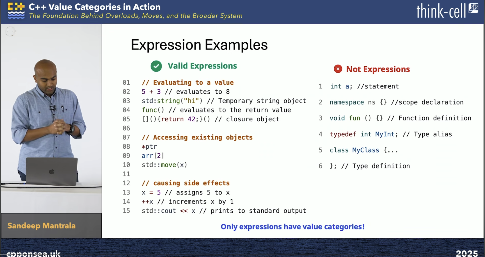

# (Im)Perfect Forwarding: A Practical Guide to Value Categories in C++

---

# Outline

1. Motivation
1. Expressions
1. Expression types
1. Value categories
1. Applications
1. Problems
1. Summary

---
# What's wrong with this code?

```cpp
template <typename Func>
auto my_invoke_bad(Func&& func) {
	return func();
}
```

---

```cpp
class Lifetime {
public:
	explicit Lifetime(std::string_view name) : name_{name} {
		std::println("{} constructor", name_);
	}
	
	~Lifetime() {
		std::println("{} destructor", name_);
	}

	Lifetime(const Lifetime& other) : name_{other.name_ + "_copy"} {
		std::println("{} copy constructor", name_);
	}

	Lifetime(Lifetime&& other) : name_{other.name_ + "_moved"} {
		std::println("{} move constructor", name_);
	}

	Lifetime& operator=(const Lifetime& other) {
		name_ = other.name_ + "_copy";
		std::println("{} copy assignment", name_);
		return *this;
	}

Lifetime& operator=(Lifetime&& other) {
	name_ = other.name_ + "_moved";
	std::println("{} move assignment", name_);
	return *this;
}

private:
	std::string name_;
};
```

---

````md magic-move
```cpp {1-4|6-9|11}
template <typename Func>
auto my_invoke_bad(Func&& func) {
	return func();
}

Lifetime const& foo() {
	static Lifetime const l{"foo"};
	return l;
}

auto const& s = my_invoke_bad(foo);
```
```cpp {11|all|2}
template <typename Func>
auto my_invoke_bad(Func&& func) {
	return func();
}

Lifetime const& foo() {
	static Lifetime const l{"foo"};
	return l;
}

static_assert(std::same_as<Lifetime, decltype(my_invoke_bad(foo))>); // ⚠️
```
```cpp {2|11}
template <typename Func>
decltype(auto) my_invoke_bad(Func&& func) {
	return func();
}

Lifetime const& foo() {
	static Lifetime const l{"foo"};
	return l;
}

static_assert(std::same_as<Lifetime const&, decltype(my_invoke_good(foo))>); // ✅
```
```cpp {11}
template <typename Func>
decltype(auto) my_invoke_bad(Func&& func) {
	return func();
}

Lifetime const& foo() {
	static Lifetime const l{"foo"};
	return l;
}

static_assert(std::same_as<Lifetime const&, decltype(my_invoke_good(foo))>); // ✅
```
````

---

# Value categories are about expressions

<v-click>

> "An expression is a sequence of operators and operands that specifies a computation[.](https://eel.is/c++draft/expr#pre-1.sentence-2) An expression can result in a value and can cause side effects[.](https://eel.is/c++draft/expr#pre-1.sentence-3)"

</v-click>

---

# Examples of C++ expressions



---

> "each C++ expression has a type and a value category"

---

# Expression type

```cpp
auto foo = <expression>;
```

---

# Expression type examples

```cpp
auto i = 1;

auto i = 1 + 2;

int a = 1;
auto i = a;

int a = 1;
int& a_ref = a;
auto i = a_ref;
```

---

# Retrieving expression type

```cpp
auto i = 1;
std::decay_t<decltype(1)> i = 1;

auto i = 1 + 2;
std::decay_t<decltype(1+2)> i = 1 + 2;
```

---

# Expression type is never a reference, `const`, or `volatile`

> "If an expression initially has the type “reference to T”, the type is adjusted to T prior to any further analysis; the value category of the expression is not altered."

> "If a prvalue initially has the type “cv T”, where T is a cv-unqualified non-class, non-array type, the type of the expression is adjusted to T prior to any further analysis."

---

# Retrieving expression type

```cpp
static_assert(std::same_as<int, std::decay_t<decltype(1)>>);

static_assert(std::same_as<int, std::decay_t<decltype(1+2)>>);

int a = 1;
int& a_ref = a;
static_assert(std::same_as<int, std::decay_t<decltype(a_ref)>>);
```

<!-- auto never gives a reference -->

---

# Value categories


Not for you...

...but for the compiler

```cpp
enum class E { one = 1, two = 2, three = 3 };

E::one = 2; // ❌
```


---

# `decltype(<variable>)`

```cpp
int i = 0;
static_assert(std::same_as<int, decltype(i)>);

int& i_ref = i;
static_assert(std::same_as<int&, decltype(i_ref)>);

int&& i_ref_ref = std::move(i);
static_assert(std::same_as<int&&, decltype(i_ref_ref)>);
```

---

# `decltype((<expr>))`

```cpp {|1|3-4|6}
static_assert(std::same_as<int, decltype((1))>); // 1 is prvalue

int i = 0;
static_assert(std::same_as<int&, decltype((i))>); // i is lvalue

static_assert(std::same_as<int&&, decltype((std::move(i)))>); // std::move(i) is xvalue
```

---

```cpp
template <typename T>
struct value_category_t {
	static constexpr auto name = "prvalue";
};

template <typename T>
struct value_category_t<T&> {
	static constexpr auto name = "lvalue";
};

template <typename T>
struct value_category_t<T&&> {
	static constexpr auto name = "xvalue";
};

template <typename T>
constexpr auto value_category = value_category_t<T>::name;

#define PRINT_VALUE_CATEGORY(E) std::println("{}: {}", #E, value_category<decltype((E))> // unevaluated
```

---

```cpp
int& i_ref = i;
static_assert(std::same_as<int&, decltype((i_ref))>); // lvalue!

int&& i_ref_ref = std::move(i);
static_assert(std::same_as<int&, decltype((i_ref_ref))>); // lvalue!
```

---

# Object access in C++

```cpp
struct S {
	int one = 1;
	int two = 2;
};

int main() {
	S s{};
	
	auto i = s.one;
	auto j = s.two;
}
```

---

# Object access in C++

```asm
s$ = 8
; ...
mov DWORD PTR s$[rsp], 1
mov DWORD PTR s$[rsp+4], 2

i$ = 0
j$ = 4
; ...
; initialize i
mov eax, DWORD PTR s$[rsp]
mov DWORD PTR i$[rsp], eax

; initialize j
mov eax, DWORD PTR s$[rsp+4]
mov DWORD PTR j$[rsp], eax
```

---

# Object access in C++

```cpp
struct S {
	int one = 1;
	int two = 2;
};

int main() {
    auto k = S{}.two;
}
```


```asm
$T1 = 24
; ...
mov DWORD PTR $T1[rsp], 1
mov DWORD PTR $T1[rsp+4], 2
mov eax, DWORD PTR $T1[rsp+4]
mov DWORD PTR k$[rsp], eax
```

---

# lvalue

Something we can take the address of.

````md magic-move
```cpp
S s{};
S* s_addr = &s;
```
```cpp
S s{};
S* s_addr = &s;

S* stemp_addr = &S{}; // error: taking address of rvalue (GCC) | error C2102: '&' requires l-value (MSVC)
```
````

---

# We can only take the address of an lvalue

````md magic-move
```cpp
int i = 0;
static_assert(std::same_as<int&, decltype((i))>); // lvalue
```
```cpp
int i = 0;
static_assert(std::same_as<int&, decltype((i))>); // lvalue

S& s_ref = S{}; // error: cannot bind non-const lvalue reference of type 'S&' to an rvalue of type 'S' (GCC) 
				// A non-const reference may only be bound to an lvalue (MSVC)
```
```cpp
int i = 0;
static_assert(std::same_as<int&, decltype((i))>); // lvalue

S& s_ref = S{}; // error: cannot bind non-const lvalue reference of type 'S&' to an rvalue of type 'S' (GCC) 
				// A non-const reference may only be bound to an lvalue (MSVC)

S const& s_constref = S{}; // temporary lifetime extension
```
````

<!-- Evaluating expression results in an rvalue/lvalue -> ... is lvalue/rvalue -->

---

# lvalue examples

```cpp
int b = 1;
PRINT_VALUE_CATEGORY(b); // lvalue
int& b_ref = b;
PRINT_VALUE_CATEGORY(b_ref); // lvalue
int&& b_ref_ref = std::move(b);
PRINT_VALUE_CATEGORY(b_ref_ref); // lvalue!
```


> "(...) named rvalue references are treated as lvalues and unnamed rvalue references to objects are treated as xvalues; rvalue references to functions are treated as lvalues whether named or not."

```cpp
assert(&b == &b_ref_ref);
```


---

# lvalue examples - pointers

```cpp
S s{};
S* p = &s;
PRINT_VALUE_CATEGORY(p); // lvalue
PRINT_VALUE_CATEGORY(*p); // lvalue
PRINT_VALUE_CATEGORY(p->member); // lvalue
PRINT_VALUE_CATEGORY((*p).member); // lvalue
```

---

# lvalue examples - functions

```cpp
void foo() {}

void (*p)() = &foo;
PRINT_VALUE_CATEGORY(foo); // lvalue
```


```cpp
int& a_ref() {
	static int a = 0;
	return a;
}

a_ref() = 5;
PRINT_VALUE_CATEGORY(a_ref()); // lvalue
```


---

# lvalue examples - array access

```cpp
int a[] = {0, 1, 2};
int* p = a;
PRINT_VALUE_CATEGORY(a); // lvalue
PRINT_VALUE_CATEGORY(p); // lvalue
PRINT_VALUE_CATEGORY(a[0]); // lvalue
PRINT_VALUE_CATEGORY(p[0]); // lvalue
```

---

# lvalue examples

```cpp
int i = 0;
PRINT_VALUE_CATEGORY(++i); // lvalue

PRINT_VALUE_CATEGORY(static_cast<int&>(i)) // lvalue
```

---

# lvalues - summary

* has a name? $\rightarrow$ lvalue
* can take address? $\rightarrow$ lvalue
* assignable? $\rightarrow$ lvalue

```cpp
auto const i_const = 1;
i_const = 2; // error, although i_const is an lvalue
auto a = 1;
auto const& a_constref = a;
a_constref = 2; // error, although a_constref is an lvalue
```

---

# rvalues

* xvalues
- prvalues

---

# prvalues ("pure rvalues")

```cpp
int x = 2;
1 = x; // error: lvalue required as left operand of assignment (GCC) 
       // error: lvalue required as left operand of assignment (MSVC)
```

---

# prvalue examples

```cpp {1|2-3|4|5-6|7-9|10|11|12|13|14|15}
PRINT_VALUE_CATEGORY(1); // prvalue
int foo();
PRINT_VALUE_CATEGORY(foo()); // prvalue
PRINT_VALUE_CATEGORY([](){}); // prvalue
enum class E { one, two, three };
PRINT_VALUE_CATEGORY(E::one); // prvalue
bool b1 = true;
bool b2 = false;
PRINT_VALUE_CATEGORY(b1 && b2); // prvalue
PRINT_VALUE_CATEGORY(3 < x); // prvalue
PRINT_VALUE_CATEGORY(&x); // prvalue
PRINT_VALUE_CATEGORY(true); // prvalue
PRINT_VALUE_CATEGORY(2.f); // prvalue
PRINT_VALUE_CATEGORY(2.); // prvalue
PRINT_VALUE_CATEGORY("foo"); // lvalue!
```

<!-- prvalue is never const or volatile, and function calls returning void are also treated as prvalues. -->

---

# `this` pointer

```cpp
struct S {
	void foo() {
		PRINT_VALUE_CATEGORY(this); // prvalue
	}
};

S s{};
s.foo();
```

---

# xvalue

```cpp
int x = 1;
PRINT_VALUE_CATEGORY(std::move(x)); // xvalue
PRINT_VALUE_CATEGORY(static_cast<int&&>(x)); // xvalue
```

---

# Value categories classification


---
layout: cover
---

# Applications

---

# Move semantics (C++11)

```cpp
void foo(const Lifetime&) {
	std::println("const&");
}

void foo(Lifetime&) {
	std::println("&");
}

void foo(Lifetime&&) {
	std::println("&&");
}

int main() {
	Lifetime l{"bar"};
	foo(std::move(l));
	foo(Lifetime{"baz"});
}
```

---

# Forwarding reference (C++11)

```cpp
template <typename T>
void foo(T&& forwarding_ref) {}

int i = 1;
foo(i); // calls foo<int&>(int&)
foo(0); // calls foo<int>(int&&)
foo(std::move(i)); // calls foo<int>(int&&)
```


---

# Simpler forwarding reference syntax (C++17)

```cpp
template <typename T>
void foo(T&& forwarding_ref) {}

void foo_cpp17(auto&& forwarding_ref) {}
```

---

# Forwarding forwarding reference

````md magic-move
```cpp
template <typename T>
void foo(T&& forwarding_ref) {
	bar(std::forward<T>(forwarding_ref));
}

void foo_cpp17(auto&& forwarding_ref) {
	bar(???);
}
```
```cpp
template <typename T>
void foo(T&& forwarding_ref) {
	bar(std::forward<T>(forwarding_ref));
}

void foo_cpp17(auto&& forwarding_ref) {
	bar(tc_move_if_owned(forwarding_ref));
}
```
````

---

# `tc_move_if_owned()`

```cpp
namespace detail {
	template <typename T>
	struct move_if_owned {
		using type = T&&;
	};
}

// T -> T&&
// T& -> T&
// T&& -> T&&
#define tc_move_if_owned(v) (static_cast<typename detail::move_if_owned<decltype(v)>::type>(v))
```

---

# Reference collapsing

---

```cpp
template <typename Func>
auto my_invoke_bad(Func&& func) {
	return func();
}

Lifetime const& foo() {
	static const Lifetime l{"foo"};
	return l;
}

int main() {
	auto const& s = my_invoke_bad(foo);
}
// foo constructor
// foo_copy copy constructor
// foo_copy destructor
// foo destructor
```

---

```cpp
template <typename Func>
decltype(auto) my_invoke_good(Func&& func) {
	return func();
}


Lifetime const& foo() {
	static const Lifetime l{"foo"};
	return l;
}

int main() {
	auto const& s = my_invoke_good(foo);
}
// foo constructor
// foo destructor
```

---

```cpp
void test_rvalue_ref_arg(int&& x_ref_ref) {
	PRINT_VALUE_CATEGORY(x_ref_ref); // lvalue!
	PRINT_VALUE_CATEGORY(std::move(x_ref_ref)); // xvalue
}

int b = 1;
test_rvalue_ref_arg(std::move(b));
test_rvalue_ref_arg(1); // prvalue-to-xvalue conversion
```

---

# Pitfalls of `std::move()`

```cpp
Lifetime l{"foo"};
Lifetime& l_ref = l;
Lifetime const& l_constref = l;
Lifetime const l_const{"foo_const"};

Lifetime l_constref_moved = std::move(l_constref); // copy
Lifetime l_const_moved = std::move(l_const); // copy
Lifetime l_ref_moved = std::move(l_ref); // move
```

---

# Safer move

```cpp
namespace detail {

template <typename Decltype>
constexpr decltype(auto) safe_move(auto&& obj) noexcept {
	static_assert(!std::is_const<std::remove_reference_t<decltype(obj)>>::value, "Cannot move out of const.");
	static_assert(!std::is_rvalue_reference<decltype(obj)>::value, "Unnecessary move; already an rvalue.");
	static_assert(!std::is_lvalue_reference<Decltype>::value, "Are you sure you want to move out of an lvalue reference?");
	
	return static_cast<std::remove_reference_t<decltype(obj)>&&>(obj);
}
}

#define safe_move(...) detail::safe_move<decltype(__VA_ARGS__)>(__VA_ARGS__)

int main() {
	int j = 1;
	safe_move(j); // OK, an lvalue
	int const k_const = 1;
	safe_move(k_const); // compile error: const
	int& j_ref = j;
	safe_move(j_ref); // compile error: lvalue reference
	safe_move(std::move(j)); // compile error: already an rvalue
	int&& j_ref_ref = std::move(j);
	safe_move(j_ref_ref)); // OK, because an lvalue
}
```

---

# What if you really want to move from an lvalue reference?

* `tc_move_always()`
* `tc_move_always_even_const()`

---

