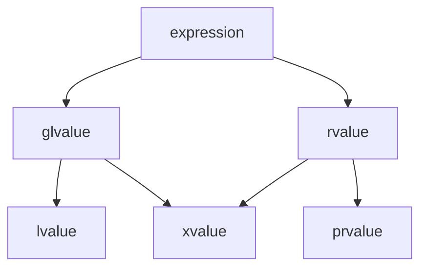

# (Im)Perfect Forwarding

## A Practical Guide to Value Categories in C++

<div class="mt-15">

Jan Wilczek

code::dive November 2026


</div>

---
layout: cover
---


<!-- Please, interrupt me. I will be showing a lot of code so you may get lost. Please, stop me and ask question, even if it's just because you fell asleep -->

---

# Outline

1. Motivation
1. Expressions
1. Expression types
1. Value categories
1. Applications
1. Problems
1. Summary

---

# What's wrong with this code?

https://godbolt.org/z/rexGsqvnj

```cpp
template <typename Func>
auto my_invoke_bad(Func&& func) {
    return func();
}
```

---
zoom: 0.8
---

# My favorite C++ class

https://godbolt.org/z/rexGsqvnj

```cpp
struct Lifetime {
    explicit Lifetime(std::string_view name) : name_{name} { std::println("{} constructor", name_); }
    ~Lifetime() { std::println("{} destructor", name_); }
    Lifetime(const Lifetime& other) : name_{other.name_ + "_copy"} { std::println("{} copy constructor", name_); }

    Lifetime(Lifetime&& other) : name_{other.name_ + "_moved"} {
        std::println("{} move constructor", name_);
    }

    Lifetime& operator=(const Lifetime& other) {
        name_ = other.name_ + "_copy";
        std::println("{} copy assignment", name_);
        return *this;
    }

    Lifetime& operator=(Lifetime&& other) {
        name_ = other.name_ + "_moved";
        std::println("{} move assignment", name_);
        return *this;
    }

private:
    std::string name_;
};
```

---

# What's wrong with this code?

https://godbolt.org/z/rexGsqvnj

```cpp
template <typename Func>
auto my_invoke_bad(Func&& func) {
    return func();
}
```

<v-click>

````md magic-move
```cpp
Lifetime const& foo() {
    static Lifetime const l{"foo"};
    return l;
}

auto const& s = my_invoke_bad(foo);
```
```cpp
Lifetime const& foo() {
    static Lifetime const l{"foo"};
    return l;
}

auto const& s = my_invoke_bad(foo);
// foo constructor
// foo_copy copy constructor
// foo_copy destructor
// foo destructor

static_assert(std::same_as<Lifetime, decltype(my_invoke_bad(foo))>); // ⚠️
```
````

</v-click>

---

# `decltype(auto)` preserves type and value category of the returned expression

https://godbolt.org/z/rexGsqvnj

````md magic-move
```cpp {2}
template <typename Func>
auto my_invoke_bad(Func&& func) {
    return func();
}

Lifetime const& foo() {
    static Lifetime const l{"foo"};
    return l;
}

auto const& s = my_invoke_bad(foo);
static_assert(std::same_as<Lifetime, decltype(my_invoke_bad(foo))>); // ⚠️
```
```cpp {2|2,11,12|14-15}
template <typename Func>
decltype(auto) my_invoke_good(Func&& func) {
    return func();
}

Lifetime const& foo() {
    static Lifetime const l{"foo"};
    return l;
}

auto const& s = my_invoke_good(foo);
static_assert(std::same_as<Lifetime const&, decltype(my_invoke_good(foo))>); // ✅

// foo constructor
// foo destructor
```
````


---
layout: quote
---

# Value categories are about expressions

<v-click>

> An expression is a sequence of operators and operands that specifies a computation[.](https://eel.is/c++draft/expr#pre-1.sentence-2) An expression can result in a value and can cause side effects[.](https://eel.is/c++draft/expr#pre-1.sentence-3)

</v-click>

---
layout: two-cols-header
---

# Examples of C++ expressions

::left::

### ✅ Expressions

```cpp {none|1,2|1,3|1,4|1,5|7,8|7,9|7,10|12,13|12,14|12,15|none}
// Evaluating to a value
5 + 3              // evaluates to 8
std::string("hi")  // temporary string object
func()       // evaluates to the return value
[](){ return 42; } // lambda

// Accessing existing objects
*ptr
arr[2]
std::move(x)

// Causing side effects
x = 5            // assigns 5 to x
++x              // increments x by 1
std::cout << x   // prints to standard output
```

::right::

### ❌ Not expressions

```cpp {none|1|3|5|7|9-11}
int a;               // declaration statement

namespace ns {}      // namespace definition

void fun() {}        // function definition

typedef int MyInt;   // type alias

class MyClass {
  // ...
};                   // class definition
```

<div class="abs-b text-left pl-15 pb-6 w-full">

<span class="text-xs opacity-60">Adapted from Sandeep Mantrala, *C++ Value Categories in Action*, C++ on Sea 2025</span>

</div>

<!-- Only expressions have value categories! -->

---
layout: quote
---

> each C++ expression has a type and a value category

---

# Expression type is never a reference

> If an expression initially has the type “reference to T”, the type is adjusted to T prior to any further analysis; the value category of the expression is not altered.

---

# Expression type

```cpp {1|2|4|5|7}
1
1 + 2

int a = 2;
a

std::move(a)
```

---

# Retrieving expression type

```cpp
static_assert(std::same_as<int, std::remove_reference_t<decltype((1))>>);

static_assert(std::same_as<int, std::remove_reference_t<decltype((1+2))>>);

int b = 1;
int& b_ref = a;
static_assert(std::same_as<int, std::remove_reference_t<decltype((b_ref))>>);
```

---

# Value categories

<p></p>

<v-clicks>

Not for you...

...but for the compiler

```cpp
enum class E { one = 1, two = 2, three = 3 };

E::one = 2; // ❌
E::one = E::two; // ❌
```

</v-clicks>

---

# `decltype(<variable>)`

https://godbolt.org/z/9seq7Y8n8

```cpp {1-2|4-5|7-8}
int i = 0;
static_assert(std::same_as<int, decltype(i)>);

int& i_ref = i;
static_assert(std::same_as<int&, decltype(i_ref)>);

int&& i_ref_ref = std::move(i);
static_assert(std::same_as<int&&, decltype(i_ref_ref)>);
```


<!-- decltype(variable) returns the type the variable was declared with -->

---

# `decltype((<expression>))`

```cpp {1|3-4|6}
static_assert(std::same_as<int, decltype((1))>); // 1 is prvalue

int i = 0;
static_assert(std::same_as<int&, decltype((i))>); // i is lvalue

static_assert(std::same_as<int&&, decltype((std::move(i)))>); // std::move(i) is xvalue
```

<!-- decltype((<expression>)) returns a type that corresponds to the value category of the expression -->

---

# Value category detector

```cpp {19|16-19|11-14|6-9|1-4}
template <typename T>
struct value_category_t {
    static constexpr auto name = "prvalue";
};

template <typename T>
struct value_category_t<T&> {
    static constexpr auto name = "lvalue";
};

template <typename T>
struct value_category_t<T&&> {
    static constexpr auto name = "xvalue";
};

template <typename T>
constexpr auto value_category = value_category_t<T>::name;

#define PRINT_VALUE_CATEGORY(E) std::println("{}: {}", #E, value_category<decltype((E))>)
```


<!-- expression given to the macro is unevaluated -->

---

# What will this print?

````md magic-move
```cpp {1-2|4-5|all}
int& i_ref = i;
PRINT_VALUE_CATEGORY(i_ref);

int&& i_ref_ref = std::move(i);
PRINT_VALUE_CATEGORY(i_ref_ref);
```
```cpp
int& i_ref = i;
PRINT_VALUE_CATEGORY(i_ref); // lvalue

int&& i_ref_ref = std::move(i);
PRINT_VALUE_CATEGORY(i_ref_ref); // lvalue
```
````

---

# Object access in C++

```cpp
struct S {
    int one = 1;
    int two = 2;
};

int main() {
    S s{};
    
    auto i = s.one;
    auto j = s.two;
}
```

---

# Object access in C++

```asm
s$ = 8
; ...
mov DWORD PTR s$[rsp], 1
mov DWORD PTR s$[rsp+4], 2

i$ = 0
j$ = 4
; ...
; initialize i
mov eax, DWORD PTR s$[rsp]
mov DWORD PTR i$[rsp], eax

; initialize j
mov eax, DWORD PTR s$[rsp+4]
mov DWORD PTR j$[rsp], eax
```

---

# Object access in C++

```cpp
struct S {
    int one = 1;
    int two = 2;
};

int main() {
    auto k = S{}.two;
}
```


```asm
$T1 = 24
; ...
mov DWORD PTR $T1[rsp], 1
mov DWORD PTR $T1[rsp+4], 2
mov eax, DWORD PTR $T1[rsp+4]
mov DWORD PTR k$[rsp], eax
```

---

# lvalue

Something we can take the address of.

````md magic-move
```cpp
S s{};
S* s_addr = &s;
```
```cpp
S s{};
S* s_addr = &s;

S* stemp_addr = &S{}; // error: taking address of rvalue (GCC) 
                      // error C2102: '&' requires l-value (MSVC)
```
````

---

# Only an lvalue can bind to a non-const lvalue reference

````md magic-move
```cpp
int i = 0;
static_assert(std::same_as<int&, decltype((i))>); // lvalue
```
```cpp
int i = 0;
static_assert(std::same_as<int&, decltype((i))>); // lvalue

S& s_ref = S{}; // error: cannot bind non-const lvalue reference of type
                // 'S&' to an rvalue of type 'S' (GCC) 
                // error: A non-const reference may only be bound to an lvalue (MSVC)
```
```cpp
int i = 0;
static_assert(std::same_as<int&, decltype((i))>); // lvalue

S& s_ref = S{}; // error: cannot bind non-const lvalue reference of type
                // 'S&' to an rvalue of type 'S' (GCC) 
                // error: A non-const reference may only be bound to an lvalue (MSVC)

S const& s_constref = S{}; // temporary lifetime extension
```
````

<!-- Evaluating expression results in an rvalue/lvalue -> ... is lvalue/rvalue -->

---

# lvalue examples

```cpp
int b = 1;
PRINT_VALUE_CATEGORY(b); // lvalue
int& b_ref = b;
PRINT_VALUE_CATEGORY(b_ref); // lvalue
int&& b_ref_ref = std::move(b);
PRINT_VALUE_CATEGORY(b_ref_ref); // lvalue!
```


> (...) named rvalue references are treated as lvalues and unnamed rvalue references to objects are treated as xvalues; rvalue references to functions are treated as lvalues whether named or not.

```cpp
assert(&b == &b_ref_ref);
```


---

# lvalue examples - pointers

```cpp
S s{};
S* p = &s;
PRINT_VALUE_CATEGORY(p); // lvalue
PRINT_VALUE_CATEGORY(*p); // lvalue
PRINT_VALUE_CATEGORY(p->member); // lvalue
PRINT_VALUE_CATEGORY((*p).member); // lvalue
```

---

# lvalue examples - functions

```cpp
void foo() {}

void (*p)() = &foo;
PRINT_VALUE_CATEGORY(foo); // lvalue
```


```cpp
int& a_ref() {
    static int a = 0;
    return a;
}

a_ref() = 5;
PRINT_VALUE_CATEGORY(a_ref()); // lvalue
```


---

# lvalue examples - array access

```cpp
int a[] = {0, 1, 2};
int* p = a;
PRINT_VALUE_CATEGORY(a); // lvalue
PRINT_VALUE_CATEGORY(p); // lvalue
PRINT_VALUE_CATEGORY(a[0]); // lvalue
PRINT_VALUE_CATEGORY(p[0]); // lvalue
```

---

# lvalue examples

```cpp
int i = 0;
PRINT_VALUE_CATEGORY(++i); // lvalue

PRINT_VALUE_CATEGORY(static_cast<int&>(i)) // lvalue
```

---

# lvalues - summary

* has a name? $\rightarrow$ lvalue
* can take address? $\rightarrow$ lvalue
* assignable? $\rightarrow$ lvalue

```cpp
auto const i_const = 1;
i_const = 2; // error, although i_const is an lvalue
auto a = 1;
auto const& a_constref = a;
a_constref = 2; // error, although a_constref is an lvalue
```

---

# rvalues

* xvalues
- prvalues

---

# prvalues ("pure rvalues")

```cpp
int x = 2;
1 = x; // error: lvalue required as left operand of assignment (GCC) 
       // error C2106: '=': left operand must be l-value (MSVC)
```

---

# prvalue examples

```cpp {1|2-3|4|5-6|7-9|10|11|12-14|15-16|17}
PRINT_VALUE_CATEGORY(1); // prvalue
int foo();
PRINT_VALUE_CATEGORY(foo()); // prvalue
PRINT_VALUE_CATEGORY([](){}); // prvalue
enum class E { one, two, three };
PRINT_VALUE_CATEGORY(E::one); // prvalue
bool b1 = true;
bool b2 = false;
PRINT_VALUE_CATEGORY(b1 && b2); // prvalue
PRINT_VALUE_CATEGORY(3 < x); // prvalue
PRINT_VALUE_CATEGORY(&x); // prvalue
PRINT_VALUE_CATEGORY(true); // prvalue
PRINT_VALUE_CATEGORY(2.f); // prvalue
PRINT_VALUE_CATEGORY(2.); // prvalue
int a = 1;
PRINT_VALUE_CATEGORY(a++) // prvalue
PRINT_VALUE_CATEGORY("foo"); // lvalue!
```

<!-- function calls returning void are also treated as prvalues. -->

---

# `this` pointer

```cpp
struct S {
    void foo() {
        PRINT_VALUE_CATEGORY(this); // prvalue
    }
};

S s{};
s.foo();
```

---

# xvalue

```cpp
int x = 1;
PRINT_VALUE_CATEGORY(std::move(x)); // xvalue
PRINT_VALUE_CATEGORY(static_cast<int&&>(x)); // xvalue
```

---

# xvalue/prvalue pitfalls

```cpp {1-5|7|9|10|11|12|11-12}
struct S {
    int member;
    int& member_ref;
    int&& member_ref_ref;
};

S make_s();

PRINT_VALUE_CATEGORY(make_s()); // prvalue
PRINT_VALUE_CATEGORY(make_s().member); // xvalue!
PRINT_VALUE_CATEGORY(make_s().member_ref); // lvalue!
PRINT_VALUE_CATEGORY(make_s().member_ref_ref); // lvalue!
```

---

# Value categories summary & heuristics

- lvalues
    - ~ things we can take the address of
    - named variables and functions
    - string literals
    - array members
    - pointer dereference
- xvalues
    - ~ unnamed rvalue references
    - members of temporaries
- prvalues
    - ~ things that are not necessarily in memory
    - temporaries
    - results of operations
    - `this`

---

# Value categories classification



---
layout: cover
---

# Quiz

---

# What is the value category of ...?

<v-clicks>

```cpp
int x; // 👈
```

Not an expression! $\implies$ No value category

</v-clicks>

---

# What is the value category of ...?

<v-clicks>

```cpp
this // 👈
```

prvalue

</v-clicks>

---

# Given the code...

<v-clicks>

```cpp
int foo();
```

## ...what is the value category of ...?

```cpp
foo // 👈
```

lvalue

</v-clicks>

---

# What is the value category of ...?

<v-clicks>

```cpp
false // 👈
```

prvalue

</v-clicks>

---

# What is the value category of ...?

<v-clicks>

```cpp
"hello, world!" // 👈
```

lvalue

</v-clicks>

---

# Given the code...

<v-clicks>

```cpp
int a = 1;
```

## ...what is the value category of ...?

```cpp
a // 👈
```

lvalue

</v-clicks>

---

# Given the code...

<v-clicks>

```cpp
int a = 1;
```

## ...what is the value category of ...?

```cpp
std::move(a) // 👈
```

xvalue

</v-clicks>

---

# Given the code...

<v-clicks>

```cpp
int a = 1;
int&& a_ref_ref = std::move(a);
```

## ...what is the value category of ...?

```cpp
a_ref_ref // 👈
```

lvalue

</v-clicks>

---

# Given the code...

<v-clicks>

```cpp
int a = 1;
```

## ...what is the value category of ...?

```cpp
&a // 👈
```

prvalue

</v-clicks>

---

# Given the code...

<v-clicks>

```cpp
int a = 1;
int* pa = &a;
```

## ...what is the value category of ...?

```cpp
pa // 👈
```

lvalue

</v-clicks>

---

# Given the code...

<v-clicks>

```cpp
int a = 1;
int* pa = &a;
```

## ...what is the value category of ...?

```cpp
*pa // 👈
```

lvalue

</v-clicks>

---

# Given the code...

<v-clicks>

```cpp
const int a_const = 2;
```

## ...what is the value category of ...?

```cpp
std::move(a_const) // 👈
```

xvalue

</v-clicks>

---

# Given the code...

<v-clicks>

```cpp
struct S {
    int member;
};
S s{3};
```

## ...what is the value category of ...?

```cpp
s // 👈
```

lvalue

</v-clicks>

---

# Given the code...

<v-clicks>

```cpp
struct S {
    int member;
};
S s{3};
```

## ...what is the value category of ...?

```cpp
s.member // 👈
```

lvalue

</v-clicks>

---

# Given the code...

<v-clicks>

```cpp
struct S {
    int member;
};
S make_s();
```

## ...what is the value category of ...?

```cpp
make_s() // 👈
```

prvalue

</v-clicks>

---

# Given the code...

<v-clicks>

```cpp
struct S {
    int member;
};
S make_s();
```

## ...what is the value category of ...?

```cpp
make_s().member // 👈
```

xvalue

</v-clicks>

---

# Given the code...

<v-clicks>

```cpp
struct S {
    int member;
};
S& get_s();
```

## ...what is the value category of ...?

```cpp
get_s() // 👈
```

lvalue

</v-clicks>

---

# Given the code...

<v-clicks>

```cpp
struct S {
    int member;
};
S&& get_s_ref_ref();
```

## ...what is the value category of ...?

```cpp
get_s_ref_ref // 👈
```

lvalue

</v-clicks>

---

# Given the code...

<v-clicks>

```cpp
struct S {
    int member;
};
S&& get_s_ref_ref();
```

## ...what is the value category of ...?

```cpp
get_s_ref_ref() // 👈
```

xvalue

</v-clicks>

---

# Given the code...

<v-clicks>

```cpp
struct S {
    int member;
};
S s{3};
```

## ...what is the value category of ...?

```cpp
std::move(s).member // 👈
```

xvalue

</v-clicks>

---
layout: image
image: /assets/socks.jpg
---

---
layout: image
image: /assets/socks_closeup.jpg
---
---
layout: cover
---

# Applications

---

# Move semantics (C++11)

```cpp
void foo(const Lifetime&) {
    std::println("const&");
}

void foo(Lifetime&) {
    std::println("&");
}

void foo(Lifetime&&) {
    std::println("&&");
}

int main() {
    Lifetime l{"bar"};
    foo(std::move(l));
    foo(Lifetime{"baz"});
}
```

---

# Forwarding reference (C++11)

```cpp
template <typename T>
void foo(T&& forwarding_ref) {}

int i = 1;
foo(i); // calls foo<int&>(int&)
foo(0); // calls foo<int>(int&&)
foo(std::move(i)); // calls foo<int>(int&&)
```

<v-click>

prvalues and xvalues are treated the same $\implies$ perfect forwarding is not perfect

</v-click>

---

# Simpler forwarding reference syntax (C++20)

"Abbreviated function template"

```cpp
template <typename T>
void foo(T&& forwarding_ref) {}

void foo_cpp20(auto&& forwarding_ref) {}
```

---

# Forwarding forwarding reference

````md magic-move
```cpp
template <typename T>
void foo(T&& forwarding_ref) {
    bar(std::forward<T>(forwarding_ref));
}

void foo_cpp20(auto&& forwarding_ref) {
    bar(???);
}
```
```cpp
template <typename T>
void foo(T&& forwarding_ref) {
    bar(std::forward<T>(forwarding_ref));
}

void foo_cpp20(auto&& forwarding_ref) {
    bar(tc_move_if_owned(forwarding_ref));
}
```
````

---

# `tc_move_if_owned()`

```cpp
namespace detail {
    template <typename T>
    struct move_if_owned {
        using type = T&&;
    };
}

// T -> T&&
// T& -> T&
// T&& -> T&&
#define tc_move_if_owned(v) \
    (static_cast<typename detail::move_if_owned<decltype(v)>::type>(v))
```

---

# Reference collapsing

```cpp
// given typename T
using TR = T&&;
```

| `T`    | `TR`  | Result |
| ------ | ----- | ------ |
| `A&`   | `T&`  | `A&`   |
| `A&`   | `T&&` | `A&`   |
| `A&&`  | `T&`  | `A&`   |
| `A&&`  | `T&&` | `A&&`  |

**Rule:** `&` always wins.

---

```cpp
template <typename Func>
auto my_invoke_bad(Func&& func) {
    return func();
}

Lifetime const& foo() {
    static const Lifetime l{"foo"};
    return l;
}

int main() {
    auto const& s = my_invoke_bad(foo);
}
// foo constructor
// foo_copy copy constructor
// foo_copy destructor
// foo destructor
```

---

```cpp
template <typename Func>
decltype(auto) my_invoke_good(Func&& func) {
    return func();
}


Lifetime const& foo() {
    static const Lifetime l{"foo"};
    return l;
}

int main() {
    auto const& s = my_invoke_good(foo);
}
// foo constructor
// foo destructor
```

---

```cpp
void test_rvalue_ref_arg(int&& x_ref_ref) {
    PRINT_VALUE_CATEGORY(x_ref_ref); // lvalue!
    PRINT_VALUE_CATEGORY(std::move(x_ref_ref)); // xvalue
}

int b = 1;
test_rvalue_ref_arg(std::move(b));
test_rvalue_ref_arg(1); // prvalue-to-xvalue conversion
```

---

# Pitfalls of `std::move()`

```cpp
Lifetime l{"foo"};
Lifetime& l_ref = l;
Lifetime const& l_constref = l;
Lifetime const l_const{"foo_const"};

Lifetime l_constref_moved = std::move(l_constref); // copy
Lifetime l_const_moved = std::move(l_const); // copy
Lifetime l_ref_moved = std::move(l_ref); // move
```

---

# Safer move

```cpp {17|2-3|4-5|7-8|10-11|13}
namespace detail {
template <typename Decltype>
constexpr decltype(auto) tc_move(auto&& obj) noexcept {
    static_assert(!std::is_const<std::remove_reference_t<decltype(obj)>>::value,
                  "Cannot move out of const.");

    static_assert(!std::is_rvalue_reference<decltype(obj)>::value,
                  "Unnecessary move; already an rvalue.");

    static_assert(!std::is_lvalue_reference<Decltype>::value,
                  "Are you sure you want to move out of an lvalue reference?");
    
    return static_cast<std::remove_reference_t<decltype(obj)>&&>(obj);
}
}

#define tc_move(...) detail::tc_move<decltype(__VA_ARGS__)>(__VA_ARGS__)
```

---

# Safer move

```cpp {2-3|4-5|6-7|8|9-10}
int main() {
    int j = 1;
    tc_move(j); // OK, an lvalue
    int const k_const = 1;
    tc_move(k_const); // compile error: const
    int& j_ref = j;
    tc_move(j_ref); // compile error: lvalue reference
    tc_move(std::move(j)); // compile error: already an rvalue
    int&& j_ref_ref = std::move(j);
    tc_move(j_ref_ref); // OK, because an lvalue
}
```

---

# What if you really want to move from...

<v-clicks>

* an lvalue reference? $\rightarrow$ `tc_move_always()`
* `const`? $\rightarrow$ `tc_move_always_even_const()`

</v-clicks>

---

# Value categories conversions

<!-- Nodes: each category appears once. Double-click any element in dev mode to drag it. -->

<div v-drag="[415,122,150,56]" class="vc-node vc-x">xvalue</div>

<div v-drag="[135,422,150,56]" class="vc-node vc-l">lvalue</div>

<div v-drag="[695,422,150,56]" class="vc-node vc-p">prvalue</div>

<!-- 1: lvalue -> xvalue -->

<div v-click>

<v-drag-arrow pos="252,422,214,-229" width="2.5" color="#374151" />

<div v-drag="[385,300,130,NaN]" class="vc-label text-left"><code>std::move()</code></div>

</div>

<!-- 2: prvalue -> xvalue -->

<div v-click>

<v-drag-arrow pos="767,422,-214,-229" width="2.5" color="#374151" />

<div v-drag="[670,245,200,NaN]" class="vc-label text-left">temporary materialization</div>

</div>

<!-- 3: xvalue, prvalue -> lvalue: not a conversion; a name is a new lvalue expression (dashed) -->

<div v-click>

<v-drag-arrow pos="449,178,-214,229" width="2.5" color="#374151" class="vc-dashed" />

<div v-drag="[130,260,180,NaN]" class="vc-label text-right">naming</div>

<v-drag-arrow pos="685,439,-390,0" width="2.5" color="#374151" class="vc-dashed" />

<div v-drag="[390,404,200,NaN]" class="vc-label text-center">naming</div>

</div>

<!-- 4: xvalue -> prvalue -->

<div v-click>

<v-drag-arrow pos="510,187,214,229" width="2.5" color="#374151" />

<div v-drag="[460,335,180,NaN]" class="vc-label text-right">lvalue-to-rvalue conversion</div>

<v-drag-arrow pos="295,461,390,0" width="2.5" color="#374151" />

<div v-drag="[340,472,300,NaN]" class="vc-label text-center">lvalue-to-rvalue conversion</div>

</div>

<style>
.vc-node {
  display: flex;
  align-items: center;
  justify-content: center;
  border: 2.5px solid;
  border-radius: 12px;
  font-size: 26px;
  font-weight: 700;
  color: #111827;
}
.vc-x { background: #ede9fe; border-color: #7c3aed; }
.vc-l { background: #dbeafe; border-color: #2563eb; }
.vc-p { background: #ffedd5; border-color: #ea580c; }
:deep(.vc-dashed line) { stroke-dasharray: 8 6; }
.vc-label {
  font-size: 20px;
  line-height: 1.2;
  color: #374151;
}
</style>

<!-- lvalue-to-rvalue conversion is like "loading a value"; sometimes that may result in a copy; how to optimize it? -->

---
layout: cover
---

# Relocating prvalues

---

# Some types are neither movable nor copyable

<v-clicks>

* `std::mutex`

- `gsl::not_null<std::unique_ptr<T>>`

- 👉 [P2785](https://wg21.link/p2785)

</v-clicks>

---

# P2785

- `reloc` keyword
- relocation constructor `T(T)`
- relocation assignment operator `T& operator=(T)`.

<!-- The reloc keyword converts an lvalue to a prvalue -->

---

# `reloc`

```cpp {all|1|2|3}
void foo(S x) {
	bar(reloc x); // simultaneous move + end lifetime
	// compiler prohibits the use of x
}
```

---

# `reloc` preserves value category

```cpp {1|2|2-3|4-5|6}
int a = 1;
int& a_ref = a;
reloc a_ref; // static_cast<int&>(a_ref)
int&& a_ref_ref = std::move(a);
reloc a_ref_ref; // static_cast<int&&>(a_ref)
reloc a; // prvalue
```

---

# (Im)perfect forwarding revisited

````md magic-move
```cpp
template <typename T>
void foo(T&& forwarding_ref) {
    bar(std::forward<T>(forwarding_ref));
}

int i = 1;
foo(i); // calls foo<int&>(int&)
foo(0); // calls foo<int>(int&&)
foo(std::move(i)); // calls foo<int>(int&&)
```
```cpp
void foo(decltype(auto) forwarding_ref) {
    bar(reloc forwarding_ref);
}

int i = 1;
foo(i); // calls foo<int&>(int&)
foo(0); // calls foo<int>(int)
foo(std::move(i)); // calls foo<int&&>(int&&)
```
````

---

# The problem is...

<div></div>

<v-click>

P2785 is stalled.

</v-click>

---

# Further problems with perfect forwarding

https://godbolt.org/z/r77zqKfsz

```cpp
template <typename T>
decltype(auto) forward_return(T&& arg) {
    return std::forward<T>(arg);
}

Lifetime l{"foo"};
auto&& r1 = forward_return(l); // returns Lifetime&
auto&& r2 = forward_return(std::move(l)); // returns Lifetime&&
auto&& r3 = forward_return(Lifetime{"bar"}); // returns Lifetime&&, "bar" destroyed at line end
r3.use(); // UB
```

---

# `tc::temporary`

```cpp
template <typename T, unsigned Lifetime>
struct temporary {
  T&& m_ref;
  ...
};
```

---

# `tc::temporary`

```cpp
template <typename T>
using prvalue_as_temporary_t = std::conditional_t<
    std::is_reference<T>::value || tc::instance_tn<T, tc::temporary>, T, tc::temporary<T, 0>>;

#define tc_prvalue_as_temporary(...) \
  static_cast<tc::prvalue_as_temporary_t<decltype((__VA_ARGS__))>>(__VA_ARGS__)
```

---

# References

## Written

1. [*Value Categories* on cppreference.com](https://en.cppreference.com/cpp/language/value_category)
1. [David Mazières, *C++ value categories and decltype demystified*](https://www.scs.stanford.edu/~dm/blog/decltype.html)
1. [Sébastien Bini, Ed Catmur, *Relocating prvalues*, C++ Standard proposal](https://wg21.link/P2785)

## Videos

1. [Ben Saks, *Back to Basics: Understanding Value Categories*, CppCon 2019](https://youtu.be/XS2JddPq7GQ?si=bQoNwXxk0c-HdMwe)
1. [Inbal Levi, *Back to Basics: Master C++ Value Categories With Standard Tools*, CppCon 2022](https://youtu.be/tH0Z2OvHAd8?si=FQA4ISNlebjP24p5)
1. [Sandeep Mantrala, *Understanding C++ Value Categories: lvalue, rvalue, xvalue, std::move, std::forward & Best Practices*, C++ On Sea 2025](https://youtu.be/d5h9xpC9m8I?si=3ac14PJmIRu64zth)

## Code

1. [thinkcell public library](https://github.com/think-cell/think-cell-library)

---

# Summary

<div class="grid grid-cols-[1fr_auto] gap-8 items-start">
<div>

<v-clicks>

* lvalue: something we can take the address of
* prvalue: temporary
* xvalue: unnamed rvalue reference
* `decltype(x)` returns the type `x` was declared with
* `decltype((x))` returns `T`, `T&`, or `T&&`, if expression `x` is a prvalue, lvalue, or an xvalue respectively
* It's worth understanding value categories to read the C++ standard
* Apply to thinkcell! [thinkcell.com/career/tech](https://www.thinkcell.com/career/tech)

</v-clicks>

</div>
<div class="flex flex-col items-start">

</div>
</div>

